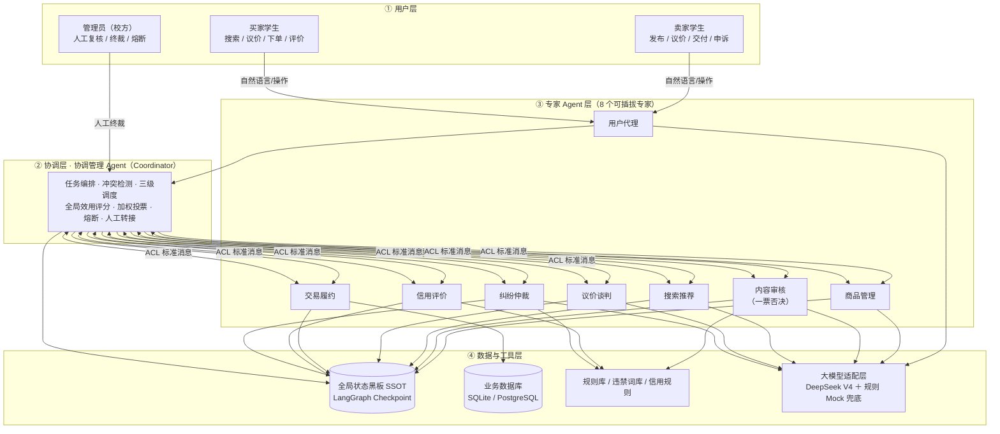
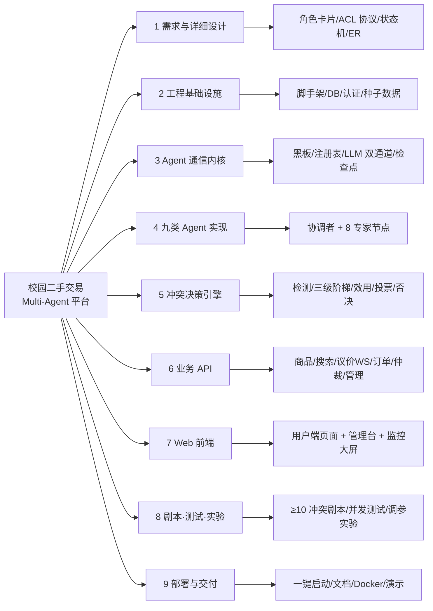
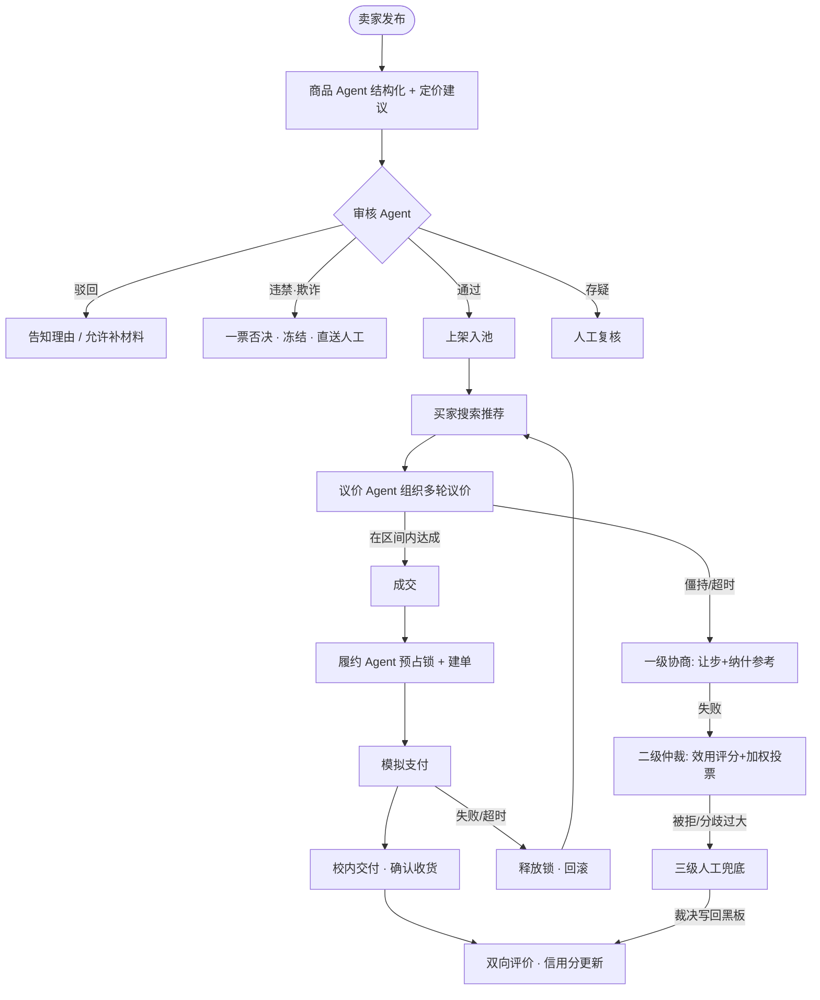
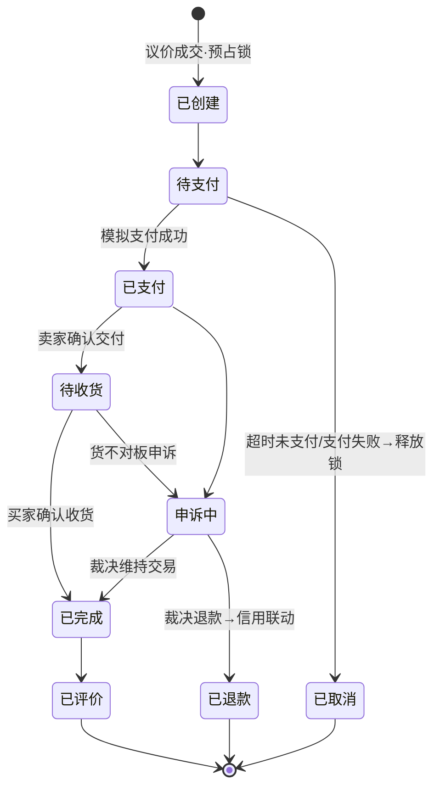

# 校园二手交易平台 Multi-Agent 系统 — 产品需求文档（PRD）

| 项目 | 内容 |
|---|---|
| 项目名称 | 校园二手交易平台 Multi-Agent 设计与实现 |
| 文档版本 | v1.0（需求评审稿） |
| 日期 | 2026-10-11 |
| 学号 / 作者 | 2400320321 梁奕琦 |
| 指导教师 | 曾志新 |
| 参考输入 | 《校园二手交易平台 Multi-Agent 设计与实现 · 周报（第 1 周 2026.9.14–9.20）》（仅作参考，本文档为最终需求依据） |
| 配套交付 | 技术栈（见第 6 章）、WBS 图（`wbs.html` 可交互版 + 本文 0.2 节）、实施任务队列（`tasks.md`） |

> 评审说明：本文档、技术栈与 WBS 经人工确认后才进入编码阶段。

---

## 0. 图表总览

### 0.1 系统总体架构（四层 + 黑板 SSOT / 消息协作）



### 0.2 WBS 工作分解结构（概览，精美可交互版见 `wbs.html`）



### 0.3 交易主链路与冲突升级流程



---

## 1. 概述

### 1.1 背景与问题

校园二手交易的核心链路为：商品发布 → 平台审核 → 搜索/推荐 → 咨询议价 → 下单支付 → 校内交付 → 确认收货 → 双向评价，异常链路包括申诉、退换与纠纷仲裁。校园场景存在四个已确认痛点：

1. **信息不对称**：商品描述失真、货不对板；
2. **信任缺失**：陌生人交易顾虑，缺乏信用约束；
3. **议价低效**：买卖双方反复砍价消耗精力、容易谈崩；
4. **纠纷处理难**：责任难界定、平台介入慢。

单一智能体难以同时承担目标相互冲突的多类任务（审核要严、推荐要撮合、议价要中立、信用要风险敏感）。本项目以多 Agent 系统（MAS）分工协作，并将**冲突检测与群体决策机制**作为研究核心，使"诚信、安全、可解释的交易"成为系统行为。

### 1.2 产品是什么

一个**可运行、可演示、可解释、可复现实验**的校园二手交易 Web 平台原型：由 **1 个协调管理 Agent + 8 个专家 Agent** 围绕"全局状态黑板（SSOT）+ 标准消息"协作，自动完成交易主链路；遇到冲突时按"**对等协商 → 协调仲裁 → 人工兜底**"三级阶梯升级，安全类判定拥有不可被覆盖的一票否决权。

### 1.3 目标用户

| 用户 | 使用目标 |
|---|---|
| 卖家学生 | 快速发布规范商品、获得定价建议、高效成交、申诉有门 |
| 买家学生 | 找到匹配商品、获得匹配理由、由 Agent 辅助议价、安全下单、维权有据 |
| 平台管理员 / 校方 | 处理人工复核与终裁、接管异常 Agent、审计全程留痕 |
| 研究者 / 答辩演示者（作者本人） | 一键运行冲突剧本、观察黑板与决策轨迹、调整效用权重做对比实验 |

---

## 2. 目标与非目标

### 2.1 目标

- G1：九类 Agent 权责清晰、通过标准消息协作，跑通完整交易主链路。
- G2：显式实现"一套冲突检测 + 三级处理阶梯 + 两类量化工具（全局效用函数、加权投票）+ 一条安全底线"，并覆盖周报表 4 的全部 8 类高频冲突场景。
- G3：关键决策可解释——审核结论、推荐理由、出价依据、仲裁裁决书均可回溯到规则、数据与置信度。
- G4：大模型负责自然语言理解与策略生成，规则库与状态机负责确定性边界；模型异常时自动降级为规则策略，演示不依赖 API Key 也能完整运行。
- G5：提供 Web 交互界面（买卖双方 + 管理员）与 Agent 运行监控，支持 ≥10 个冲突模拟剧本一键运行。

### 2.2 非目标（明确排除）

- ❖ 真实支付通道与资金清算（仅沙箱模拟支付、超时与失败回滚）。
- ❖ 真实物流系统（仅校内面交/自提点登记与交付确认）。
- ❖ 校方统一身份认证对接、实名学籍核验（用种子学号账号模拟）。
- ❖ 原生移动 App、离线消息推送、生产级高并发集群部署。
- ❖ 基于真实交易数据的机器学习训练（无真实样本，规则与经验权重 + 可配置实验）。

---

## 3. 范围

### 3.1 P0 —— 最小完整旅程（本期必须完成）

- **入口**：学生凭种子账号（学号）登录，分别可作为卖家/买家。
- **卖家旅程**：发布商品（支持自然语言描述）→ Agent 结构化、分类、成色标签与定价区间建议 → 审核（通过上架 / 驳回补材料 / 违禁拦截 / 存疑转人工）→ 参与议价 → 确认交付 → 评价/被评价 → 可发起申诉。
- **买家旅程**：多条件搜索与个性化推荐（附匹配理由）→ 进入议价室多轮议价（Agent 辅助出价、纳什参考价、僵局处理）→ 成交后下单、模拟支付、确认收货、双向评价 → 可发起申诉。
- **恢复路径**：并发抢单失败者被释放并获得替代推荐；支付失败/超时释放锁；议价破裂推荐同类商品；纠纷经仲裁裁决；安全事件被拦截并冻结。
- **管理员旅程**：人工复核台（审核存疑、三级纠纷终裁）、证据包查看、裁决写回、Agent 熔断/接管、全程审计。
- **冲突机制**：第 8 章 8 类场景全部可演，且至少 10 个剧本可一键运行。

### 3.2 P1 —— 支撑演示与研究（资源允许则完成）

- Agent 黑板状态与决策轨迹监控大屏（含冲突事件流、效用得分构成、信用分变化）。
- 效用权重与议价参数可在界面配置并跑对比实验（输出 A/B 结果）。

---

## 4. 角色、对象与状态模型

### 4.1 Agent 角色（1 协调者 + 8 专家，源自周报表 2，作为本系统的权威定义）

| # | Agent | 定位 | 关键输入 | 关键输出/决策 |
|---|---|---|---|---|
| ① | 协调管理 Coordinator | 调度中枢与裁判长：编排、注册管理、状态监控、冲突终裁、熔断与人工转接 | 用户请求、各 Agent 上报 | 分派指令、裁决、流程跳转/熔断 |
| ② | 用户代理 User Agent | 用户数字分身（按买家/卖家实例化）：意图理解、画像偏好底线、代客议价 | 用户指令、历史行为、对方报价 | 结构化意图、出价策略、确认请求 |
| ③ | 商品管理 Commodity | 上架管家：结构化、自动分类、成色标签、定价区间、库存与上下架 | 描述与图片、历史成交价 | 标准商品档案、建议价、上架结果 |
| ④ | 内容审核 Moderation | 安检员：违禁品/虚假描述/敏感图文/欺诈识别；**安全一票否决** | 商品档案、用户历史 | 结论 + 置信度 + 依据 |
| ⑤ | 搜索推荐 Search | 导购员：多条件检索、意向匹配、个性化排序 | 搜索请求、画像、商品池 | 排序列表 + 匹配理由 |
| ⑥ | 议价谈判 Negotiation | 中立主持人：组织双边多轮出价、让步策略、纳什参考价、僵局识别 | 双方底价、轮次、时限 | 撮合价/破裂结论、议价记录 |
| ⑦ | 交易履约 Order | 账房调度：订单状态机、商品锁定防抢单、支付交付跟踪、超时处理 | 成交请求、支付/交付事件 | 订单状态、锁/解锁、结算结果 |
| ⑧ | 信用评价 Credit | 信用局：双向评价聚合、信用分动态计算、风险标签 | 评价、履约记录、举报 | 信用分、风险标签、可信度意见 |
| ⑨ | 纠纷仲裁 Arbitrator | 线上小法官：证据链汇总、规则库裁决、重大纠纷上报人工 | 申诉、全链路证据 | 裁决书（责任+依据）、处罚建议 |

**角色粒度说明（回应周报问题 1）**：本期保留 9 类角色，但实现为"协调者 + 8 个遵循同一契约的专家节点"，商品管理与审核、仲裁与信用之间通过消息契约解耦；是否在后续研究中合并角色，依据运行数据中的通信开销再定，本期不做物理合并。

### 4.2 核心业务对象（规范定义，字段级在详细设计中落表）

| 对象 | 关键属性（要点） |
|---|---|
| 用户 User | 用户ID、学号、昵称、角色身份（买家/卖家可兼）、信用分、风险标签、状态 |
| 商品 Item | 商品ID、卖家ID、标题、标准类目、成色、描述/图片、建议价区间、状态、锁定版本号 |
| 议价会话 Negotiation | 会话ID、商品ID、买卖双方、双方底价、轮次、时限、纳什参考价、出价序列、结果 |
| 订单 Order | 订单ID、会话/商品ID、双方、成交价、状态机状态、锁令牌、时间戳、超时点 |
| 评价 Review | 订单ID、评分、文本、双向、是否计入信用 |
| 申诉/纠纷 Case | 案件ID、订单ID、申诉方、类型、证据包、裁决书、责任划分、处罚、级别 |
| ACL 消息 Message | 消息ID、对话ID、言语行为、发送/接收方、内容、置信度、超时、异常码、时间戳 |
| 冲突事件 ConflictEvent | 类型（资源/目标/知识/决策/安全）、检测方式、级别、参与方、处理过程与结果 |
| Agent 记录 AgentProfile | 名称、能力契约、健康状态、是否被熔断 |

### 4.3 商品与订单状态（唯一权威定义）

- **商品**：`草稿 → 待审核 → 在售（被锁定）→ 已成交 →（下架/驳回/冻结）`；`被锁定`仅持锁订单可见可支付，其余请求触发资源冲突流程。
- **订单状态机**：



---

## 5. 功能需求索引（摘要）

> 完整功能需求见第 7 章；冲突决策相关需求集中见第 8 章。

| 模块 | 需求编号 | 一句话能力 |
|---|---|---|
| 账号认证 | FR-1 | 学号注册/登录、JWT、角色、种子账号 |
| 用户代理 Agent | FR-2 | 自然语言意图、画像与底价、代客出价（关键出价需用户确认） |
| 商品管理 Agent | FR-3 | 发布结构化、分类成色、定价建议、上下架 |
| 内容审核 Agent | FR-4 | 违禁/虚假/欺诈判定，三档处置，一票否决 |
| 搜索推荐 Agent | FR-5 | 检索、匹配、带理由排序，佣金偏向可被纠偏 |
| 议价谈判 Agent | FR-6 | 双边多轮议价、让步与纳什参考、僵局/破裂 |
| 交易履约 Agent | FR-7 | 订单状态机、预占锁与并发抢单优先级、超时释放、回滚 |
| 信用评价 Agent | FR-8 | 互评聚合、信用分与风险标签、风险意见输出 |
| 纠纷仲裁 Agent | FR-9 | 证据链、规则裁决书、处罚建议、超限升级人工 |
| 协调管理 Agent | FR-10 | 编排、四法冲突检测、三级调度、熔断、人工转接 |
| 黑板与消息协议 | FR-11 | SSOT 黑板、FIPA ACL 风格消息、异常码 |
| 人工工作台 | FR-12 | 复核、终裁、证据包、熔断接管、裁决写回 |
| 可解释与审计 | FR-13 | 决策依据、裁决书、留痕可回放 |
| 冲突剧本模拟 | FR-14 | ≥10 剧本一键运行与结果报告 |
| Web 前端 | FR-15 | 买卖端 + 管理端 + 监控可视化 |

---

## 6. 技术栈选型（需求方明确要求的交付项）

### 6.1 选型调研结论（2026-10 时效核查）

| 结论 | 证据（P0/P1 来源） | 对本项目的影响 |
|---|---|---|
| LangGraph 持续活跃，已到 **1.2.x（2026-05 发布）**，检查点（checkpointer）原生支持持久化、human-in-the-loop、故障恢复与时间旅行 | PyPI `langgraph 1.2.2`；LangChain 官方 Changelog / Checkpointers 文档 | 周报"主编排倾向 LangGraph"的判断成立，确定为**唯一核心编排框架** |
| **AutoGen 已进入维护模式**（不再新增特性、社区维护），其继任者 **Microsoft Agent Framework 1.0 于 2026-04-02 GA**（融合 AutoGen + Semantic Kernel） | microsoft/autogen README 维护公告（2026-08 核验）；MAF BUILD 2026 公告；PyPI semantic-kernel 说明 | **新项目不再以 AutoGen 为依赖**；议价的多轮 GroupChat 思想直接用 LangGraph 双边节点循环实现，避免双框架风险；MAF 列为"后续研究备选"，回应周报问题 6 |
| 国产模型 **DeepSeek V4（Pro/Flash）** 提供国内直连、OpenAI 兼容接口，Agent 能力显著增强，成本约 3 元/百万输入级 | DeepSeek API 文档及 2026 年公开定价报道 | 作为首选 LLM；另备 Qwen / GLM / Kimi 同构接口可切换 |
| 无真实交易样本、LLM 存在格式漂移与幻觉风险（周报问题 4、7） | 周报自述 | 采用"**LLM + 规则引擎双引擎**"：Pydantic 结构化输出 → 规则后置校验 → 失败重试 → 规则 Mock 兜底；无 API Key 也能全流程演示，保证答辩稳定 |

### 6.2 技术栈总表

| 层 | 选型 | 版本/说明 | 选择理由 |
|---|---|---|---|
| 语言 | Python | 3.11+ | 周报既定方向；AI 生态最全 |
| Agent 编排 | **LangGraph** | 1.x | 显式图状态、条件边/子图、Checkpointer 持久化、`interrupt` 人工介入，天然映射"协商→仲裁→人工"回环与黑板 SSOT |
| LLM 接入 | openai SDK（OpenAI 兼容） | 接 DeepSeek V4，可切 Qwen/GLM | 国内直连、低成本、Agent 能力强；一套接口多供应商 |
| LLM 兜底 | 自研规则策略引擎 `RuleLLM` | 确定性 | 无 Key/超时/格式错误时自动降级，输出永远合法 |
| 数据校验 | Pydantic / SQLModel | 2.x | 消息契约、Agent IO、结构化输出一体校验 |
| 后端 | **FastAPI** + Uvicorn | 最新稳定 | 异步、自动 OpenAPI 文档、WebSocket 支持议价实时消息 |
| ORM / 数据库 | SQLModel + **SQLite（WAL）** | 零配置；可一行切换 PostgreSQL | 课程机零安装可跑；状态机/锁用事务 + 乐观版本号保证正确；预留 Postgres |
| 并发控制 | asyncio 锁 + 数据库乐观更新/唯一约束 | — | 商品预占锁、抢单优先级；不引入 Redis 也能保证单机演示正确（回应周报问题 5） |
| 认证 | python-jose（JWT）+ passlib[bcrypt] | — | 学号登录、角色鉴权 |
| 前端 | **Vue 3 + TypeScript + Vite + Pinia + Vue Router + Element Plus** | 现行稳定 | 上手快、组件成熟、中文生态；适合校园项目快速交付 |
| 可视化 | ECharts | 5.x | 监控大屏：冲突事件、效用构成、信用趋势 |
| 实时通信 | WebSocket（原生） | — | 议价室出价流、Agent 状态/黑板推送 |
| 测试 | pytest + pytest-asyncio + httpx | — | Agent 单测、API 测试、并发抢单测试、剧本回归 |
| 工程化 | venv/uv、ruff、pydantic-settings、`.env` | — | 配置化（API Key、权重、阈值） |
| 部署（P1） | Docker Compose（前端+后端+DB 一卷） | 可选 | 老师机器上一键拉起；不装 Docker 则提供启动脚本 |

### 6.3 工程结构（技术视角，目录级，编码阶段落地）

```text
backend/
  app/
    main.py                # FastAPI 入口、WS 路由
    core/                  # 配置、安全、数据库、锁管理
    agents/                # 9 个 Agent：base 契约 + coordinator + 8 experts
    graph/                 # LangGraph 状态图、节点、条件边、checkpoint
    kernel/                # ACL 消息、黑板 SSOT、注册表、冲突检测、效用/投票
    llm/                   # LLM 适配（DeepSeek/OpenAI 兼容）+ RuleLLM 兜底
    models/  schemas/  services/  api/
    seeds/                 # 种子账号与商品
    scenarios/             # ≥10 冲突剧本
  tests/
frontend/
  src/views/  components/  stores/  api/  ws/
```

---

## 7. 功能需求（详述）

> 描述规则：每条给出【触发】【处理规则】【结果与状态】【异常】。金额均为人民币模拟币。

### FR-1 账号与认证

- 【触发】用户注册/登录；系统初始化。
- 【规则】以学号 + 密码注册，密码 bcrypt 哈希；登录签发 JWT；同一账号可同时具有买家/卖家身份；管理员为独立预置账号。系统内置种子账号（含作者学号 2400320321 及若干买家/卖家），首次启动自动播种，便于直接演示。
- 【结果】获得身份令牌；可访问对应角色的操作。
- 【异常】错误口令拒绝；过期令牌 401；被冻结账号禁止交易类操作但可申诉。

### FR-2 用户代理 Agent（User Agent）

- 【触发】用户发送自然语言或页面指令（如"帮我砍到 200 以内""把这本高数资料卖了"）。
- 【规则】输出结构化意图（发布/搜索/出价/接受/拒绝/申诉…）；按身份维护画像与偏好；议价时维护**用户底价/保留价**；Agent 可自动在授权区间内出价，**超越授权区间或最终成交前必须弹出确认点**（human-in-the-loop）。
- 【结果】意图与策略进入黑板；用户确认结果写回。
- 【异常】意图无法解析时引导澄清，禁止猜测后直接执行资金相关动作。

### FR-3 商品管理 Agent（Commodity）

- 【触发】卖家提交描述（可含图片 URL/上传占位）。
- 【规则】抽取标题、类目、成色标签、关键属性；依据同类历史成交价（种子数据）给**建议价区间**（仅建议，卖家可改）；生成标准商品档案；状态置`待审核`。卖家可主动下架未锁定商品。
- 【结果】标准档案入黑板/库，触发审核。
- 【异常】信息严重缺失则退回补充；图片为可选（P0 不做真实 OCR 鉴黄，图文风险由规则 + LLM 文本判定）。

### FR-4 内容审核 Agent（Moderation）

- 【触发】商品建档完成；或卖家对驳回申诉。
- 【规则】综合违禁词/规则库（危险品、违禁品、校园禁止交易物等）与 LLM 判定，输出 `通过 / 驳回 / 人工复核`，**附置信度与逐条依据**。命中违禁或欺诈特征时结论为**安全否决（veto）**。
- 【结果】通过→`在售`；驳回→告知理由并允许补材料一次重提；存疑→进入人工复核台；veto→商品冻结、通知卖家、证据直送管理员，**该判定不可被任何投票或效用得分覆盖**（AC-1）。
- 【异常】LLM 不可用时走规则库；规则与模型结论冲突且置信度接近时升级人工复核。

### FR-5 搜索推荐 Agent（Search）

- 【触发】买家关键词/条件检索、首页推荐。
- 【规则】仅检索`在售`商品；综合相关性、成色、价格匹配度、卖家信用、买家画像排序；**每个推荐给出可展示的匹配理由**。排序方案须通过协调者的目标相容性检查：当方案明显偏向平台佣金而偏离买家需求（用户满意度项不达标）时被要求重排（周报表 4 场景 5）。
- 【结果】返回带理由列表。
- 【异常】无结果时给出宽松条件建议与替代类目。

### FR-6 议价谈判 Agent（Negotiation）

- 【触发】买家对在售商品发起议价；双方后续轮次出价。
- 【规则】
  1. 以双方保留价（买家最高价、卖家最低价，对对手不可见）与当前报价维护会话；设定**最大轮次（默认 5）与时限（默认 120 秒，可配置）**；
  2. 采用**单调让步**：买家出价不下降、卖家要价不上升；让步幅度可随时间压力增大；
  3. 给出**纳什参考价**（在可行成交区间内使双方让步空间乘积最大的参考点）作为撮合建议；
  4. 任一方接受、或出价进入双方区间即成交；**超轮次/超时/一方明确退出则破裂**，终止会话并向买家推荐同类商品；
  5. 信用 Agent 的风险信号可作为主持人提示（如新号风险提示），但不直接代替用户决策；
  6. 全程出价序列与依据留痕；突破用户授权区间的出价须经用户确认。
- 【结果】`撮合价成交 → 触发下单锁定` 或 `谈判破裂`。
- 【异常】僵持满足时限+轮次条件先走**一级协商**（自动让步建议/规则解释/纳什参考），一级失败升级二级（第 8 章）。

### FR-7 交易履约 Agent（Order）

- 【触发】议价成交；支付/交付/超时事件。
- 【规则】
  1. **预占锁**：成交瞬间对商品加锁（锁令牌 + 乐观版本号 + 超时点），其他并发下单触发资源冲突；
  2. **抢单裁决**：多买家竞争同一商品时按"下单时间优先 → 信用分优先 → 支付完成优先"排序，一名成交，其余自动释放并推荐替代商品；
  3. 订单严格按 4.3 状态机迁移，非法迁移一律拒绝；
  4. 支付为沙箱模拟：买家"支付"后置`已支付`；**支付超时（默认 15 分钟可配）或失败 → 取消订单、释放锁、库存回滚**；
  5. 校内面交：卖家确认交付→买家确认收货→`已完成`。
- 【结果】订单状态、锁状态、结算结果可查。
- 【异常】已锁定/已成交商品收到新下单请求即资源冲突；重复支付幂等拒绝。

### FR-8 信用评价 Agent（Credit）

- 【触发】订单完成双方互评；出现违规/取消/仲裁结果。
- 【规则】订单完成后开放双向评分（1–5）+文本；信用分按既定规则动态更新（初始分、评价加权、履约/取消/欺诈加减分，**规则与初值在详细设计中给出并配置化**）；输出用户风险标签（如新号、高取消率、高风险）；向审核、议价、订单、仲裁输出**带置信度的风险意见**。
- 【结果】信用分与标签持久化并在用户主页/交易提示中可见；处罚由仲裁/安全事件触发联动。
- 【异常】恶意刷评识别为 P1（P0 至少保证一单仅能评价一次）。

### FR-9 纠纷仲裁 Agent（Arbitrator）

- 【触发】买家/卖家就订单发起申诉（货不对板、未交付、恶意退款等）。
- 【规则】汇总证据包（商品档案、议价记录、订单/支付/交付节点、聊天/留言、信用历史）；依据规则库输出**裁决书**：责任划分、判定依据条目、执行方案（维持交易/退款退货/警告/信用扣罚）、置信度；**金额超阈值、涉违禁/校园安全或规则无法覆盖的案件升级三级人工**；仲裁结论联动信用 Agent。
- 【结果】裁决书可查看、可回溯；终裁写回黑板并驱动订单状态迁移。
- 【异常】证据不足时要求补证，不得臆断。

### FR-10 协调管理 Agent（Coordinator）

- 【触发】所有用户请求与 Agent 上报。
- 【规则】负责任务分解与图编排、Agent 注册与能力发现、全局状态监控；执行第 8 章全部冲突检测与三级调度；对异常/失控 Agent 拥有**熔断隔离权**（被熔断 Agent 的职责临时由协调者代管并告警）；通过 `interrupt` 把三级事件移交人工并在裁决后恢复主流程。
- 【结果】流程跳转、裁决与熔断均留痕。

### FR-11 黑板 SSOT 与消息协议

- 【规则】全部 Agent 围绕类型化的全局状态黑板（由 LangGraph State + Checkpointer 承载）协作；Agent 间不私自共享可变状态；消息采用 **FIPA ACL 风格统一 Schema**：`消息ID、对话ID、言语行为(performative，如 request/inform/propose/accept/reject/refuse/arbitrate/veto)、发送方、接收方、内容负载、置信度、超时、异常码、时间戳`；以黑板为准自动纠正私有状态偏差并记录偏差来源（周报问题 3 的落地）。
- 【结果】任意时刻系统状态唯一、可查、可回放。

### FR-12 人工工作台（管理员）

- 【规则】提供待办队列：商品人工复核、纠纷三级终裁、安全事件处置、被熔断 Agent 接管；可查看完整证据包；终裁结论**写回黑板并触发信用处罚/订单流转**；所有人工动作强制留痕（操作人、时间、依据）。

### FR-13 可解释与审计

- 【规则】审核结论、推荐理由、每轮出价依据、仲裁裁决书、冲突升级路径均可在前端查看；基于检查点提供一次交易/一场纠纷的**决策轨迹回放**。

### FR-14 冲突剧本模拟

- 【规则】内置不少于 **10 个**剧本（议价破裂、并发抢单、审核申诉、货不对板仲裁、恶意退款、欺诈拦截、状态不一致自动纠正、信用/订单意见相左、推荐偏向纠偏、人工兜底终裁等，覆盖第 8 章 8 类场景）；支持命令行/界面一键运行，输出逐步轨迹与期望结果对照表。

### FR-15 Web 前端

| 端 | 页面 |
|---|---|
| 通用 | 登录/注册、首页 |
| 卖家 | 商品发布（自然语言）、我的商品（审核状态/依据）、议价室、订单与交付、收到的评价、申诉 |
| 买家 | 市场搜索/推荐（带理由）、商品详情、议价室（出价/纳什参考/倒计时/轮次）、下单与模拟支付、确认收货、我的订单、评价、我的信用、申诉 |
| 管理员 | 人工复核台、纠纷终裁台、安全事件、Agent 熔断管理、审计/轨迹回放 |
| 监控（P1） | 黑板实时状态、冲突事件流、效用得分构成、信用分布（ECharts） |

---

## 8. 冲突决策机制需求（本项目研究核心）

### 8.1 冲突检测（四种，必须全部实现）

1. **规则检测**：状态机/锁校验（如已锁定商品收到下单 → 资源冲突）；
2. **意见检测**：多 Agent 对同一对象给出带置信度结论，结论相左且置信度接近 → 决策冲突；
3. **目标检测**：各 Agent 行动提案统一做目标相容性检查（如推荐佣金目标 vs 买家满意目标）；
4. **信息检测**：Agent 私有状态与黑板 SSOT 比对，不一致即信息冲突并自动纠正、记录偏差来源。

### 8.2 三级处理阶梯（逐级升级、全程留痕）

| 级别 | 触发 | 方式 | 出口 |
|---|---|---|---|
| 一级·对等协商 | 冲突初发、当事 Agent 可直接谈判 | 限时（≤3 轮）自动让步、纳什参考价、规则解释、允许补材料 | 成功→留痕恢复主流程；失败→升级二级 |
| 二级·协调仲裁 | 协商失败或多 Agent 意见相左 | 协调者主持：全局效用函数评分 + 相关 Agent 加权投票（票权×置信度） | 出具含依据裁决书；被拒/分歧过大→三级 |
| 三级·人工兜底 | 涉资金/违禁/校园安全，或金额超阈值 | 立即冻结相关操作，仲裁 Agent 汇总证据包，提交管理员/校方终裁 | 人工裁决写回黑板，联动信用处罚，恢复/终止流程 |

### 8.3 两类量化工具（参数配置化，初值可改）

- **全局效用函数**：`U = 0.25·用户满意度 + 0.20·交易成功率 + 0.30·平台安全性 + 0.15·公平性 − 0.10·处理成本`；权重写入配置，P1 支持界面调参做对比实验（回应周报问题 2）。
- **加权投票（含置信度）**：风险类决策由信用、审核、交易等相关 Agent 投票，按专业相关性赋权并乘以各自置信度；平票或分歧过大升级二级仲裁/暂缓支付。

### 8.4 安全底线（最高优先级，不可被覆盖）

内容审核 Agent 对违禁品、欺诈交易拥有**一票否决权**，任何投票/效用得分均不得覆盖；协调者可**熔断隔离**异常 Agent 并临时代管。实现上以确定性规则优先于模型输出。

### 8.5 必须覆盖的 8 类冲突场景（验收映射周报表 4）

| # | 场景 | 类型 | 处置要点 | 主责 |
|---|---|---|---|---|
| C1 | 议价僵持互让 | 目标 | 一级时间压力让步+纳什参考；超时破裂并推荐同类 | 议价 |
| C2 | 多买家并发抢同一商品 | 资源 | 预占锁 + 三优先排序；失败者释放+替代推荐 | 履约 |
| C3 | 卖家不服审核驳回 | 决策/知识 | 一级解释补材料 → 二级规则库复核 → 三级人工 | 审核/仲裁 |
| C4 | 货不对板/未交付纠纷 | 目标 | 二级证据链裁决 + 信用扣罚；超阈值三级人工 | 仲裁 |
| C5 | 推荐偏向佣金、不符需求 | 目标 | 二级效用比较，满意度不达标要求重排 | 协调者 |
| C6 | 信用判高风险 vs 订单判可成交 | 决策 | 二级加权投票（风险权重高），分歧大则暂缓支付并升级 | 协调者 |
| C7 | Agent 间状态不一致 | 信息 | 以 SSOT 自动纠正并记录偏差来源 | 协调者 |
| C8 | 疑似欺诈/违禁品 | 安全 | 立即拦截+一票否决，冻结并证据直送人工 | 审核 |

---

## 9. 非功能需求

| 编号 | 需求 | 可验证标准 |
|---|---|---|
| NFR-1 可解释 | 每次审核/推荐/出价/仲裁给出依据与置信度 | 裁决书与理由在界面可见、可回溯 |
| NFR-2 一致性 | 同一商品不可重复成交 | 并发测试下恰一单成交（AC-3） |
| NFR-3 及时性 | 常规操作秒级；议价单轮含 LLM 的 P95 ≤ 3 秒（本机/校园网） | 剧本计时；超时自动降级 |
| NFR-4 安全可控 | 密码哈希、JWT、数据按用户隔离、违禁必拦、veto 不可覆盖 | 安全剧本与接口测试 |
| NFR-5 可扩展 | Agent 遵循统一契约、注册表发现，可插拔 | 新增一个示例 Agent 不改协调核心（AC-9） |
| NFR-6 LLM 稳定 | 结构化输出→校验→重试→规则兜底；关键动作人工确认点 | 注入故障/无 Key 测试，系统不产生脏状态（AC-8、AC-15） |
| NFR-7 可复现 | 无 API Key 可完整跑通 P0 与全部剧本；种子数据；一键启动 | 全新环境按 README 启动成功 |
| NFR-8 可观测 | 检查点、结构化日志、冲突事件记录、轨迹回放 | 监控台/日志可查 |
| NFR-9 工程质量 | 后端类型注解覆盖核心模块；核心逻辑 pytest 覆盖；前后端可独立启动 | 测试通过、README 可执行 |

---

## 10. 约束、依赖与假设

### 10.1 约束

- 技术：Python 技术栈；单机开发与演示（Windows）；不依赖外部基础设施即可运行（SQLite/内置锁）。
- 业务：校园内二手实物商品；模拟支付；规则库与权重为经验初值，无真实数据训练。
- 时间：课程研究项目，按 WBS 分阶段交付，支撑后续周报与答辩。

### 10.2 依赖

- DeepSeek（或兼容供应商）API Key —— **可选**，缺失时 RuleLLM 全量兜底。
- Node.js（前端构建）、Python 3.11+。

### 10.3 假设（评审时请确认，见第 12 章）

- [Assumption] 默认提供 Mock 模式，答辩演示不强制联网/API Key；作者提供 Key 时启用真实 LLM。
- [Assumption] 前端采用 Vue 3 + Element Plus。
- [Assumption] 金额阈值、议价轮次/时限、效用权重等均为配置化初值，可在详细设计与实验中调整。
- [Assumption] P0 不做真实图片鉴黄与文件云存储，图片以 URL/本地占位 + 文本审核为主。

---

## 11. 验收标准

> 类型：`rule` = 客观二元条件；`rubric` = 评分维度（1–5）。

### AC-1 安全一票否决不可覆盖 `rule`
- **Given** 卖家发布的商品命中违禁/欺诈规则；**When** 任何其他 Agent 投票或效用计算倾向放行；**Then** 商品仍被冻结、不得上架，证据直送人工；**Evidence**：C8 剧本运行记录 + 商品状态 + 审计日志。

### AC-2 交易主链路端到端贯通 `rule`
- **Given** 买卖双方种子账号；**When** 依次执行发布→审核通过→搜索→议价成交→下单→模拟支付→交付确认→互评；**Then** 订单到`已评价`、商品`已成交`、双方信用分更新，全过程决策依据可查；**Evidence**：端到端剧本 + 数据库/界面截图。

### AC-3 并发抢单一致性 `rule`
- **Given** 同一在售商品；**When** 两个买家会话并发发起成交/支付；**Then** 恰好一单成功，另一单被拒并释放/获得替代推荐，不出现超卖；**Evidence**：并发测试（pytest 两路同时下单）输出。

### AC-4 议价规则正确性 `rule`
- **Given** 议价会话；**When** 发生多轮出价、成交、超轮次/超时三种情形；**Then** 出价满足单调让步、区间内成交、超限时破裂并推荐同类；纳什参考价被计算并展示；**Evidence**：C1 等剧本的出价序列断言。

### AC-5 三级冲突阶梯可升级且可回溯 `rule`
- **Given** 一个一级协商失败且分歧过大的纠纷；**When** 系统逐级处理；**Then** 自动产生二级裁决书（效用+加权投票记录），满足条件时经 `interrupt` 转三级人工、操作被冻结，人工裁决写回黑板并恢复/终止流程；每级留痕；**Evidence**：C3/C4 剧本轨迹。

### AC-6 SSOT 信息冲突自动纠正 `rule`
- **Given** 某 Agent 私有状态与黑板不一致；**When** 信息检测运行；**Then** 以黑板为准纠正并记录偏差来源；**Evidence**：C7 剧本日志。

### AC-7 八类冲突场景全覆盖 `rule`
- **Then** C1–C8 均有可运行剧本，结果符合 8.5 处置要点，且剧本总数 ≥ 10；**Evidence**：`scenarios/` 目录 + 一键运行结果对照表。

### AC-8 无 Key 可完整演示 `rule`
- **Given** 环境不配置任何 LLM API Key；**When** 运行 P0 主链路与全部剧本；**Then** 全部成功完成且输出结构合法；**Evidence**：CI/本地无 Key 运行日志。

### AC-9 Agent 可插拔 `rule`
- **Given** Agent 基类契约与注册表；**When** 新增一个实现契约的示例 Agent 并注册；**Then** 无需修改协调者核心代码即可被编排调用；**Evidence**：示例 Agent + 注册测试。

### AC-10 决策轨迹可回放 `rule`
- **Given** 任一完成的交易或纠纷；**When** 打开审计/回放；**Then** 可按检查点重放各 Agent 消息、结论、置信度与冲突升级路径；**Evidence**：回放界面/导出轨迹。

### AC-11 ACL 消息协议统一 `rule`
- **Then** Agent 间全部消息经统一 Schema 校验（对话ID/言语行为/置信度/超时/异常码齐备），非法消息被拒；**Evidence**：消息校验单测。

### AC-12 LLM 故障不产生脏状态 `rule`
- **Given** 模拟 LLM 返回非法 JSON/超时；**When** 触发审核与议价；**Then** 经重试后降级规则策略或挂起转人工，黑板状态保持一致；**Evidence**：故障注入测试。

### AC-13 前端完成度与易用性 `rubric`
- **维度**：三类用户核心旅程的页面完整性、交互反馈、错误提示与信息清晰度；**Scale 1–5**：1=页面残缺不可用；3=主流程可用但反馈弱；5=全流程顺畅、状态与依据清晰；**阈值 ≥ 4**；**Evidence**：逐页走查截图。

### AC-14 决策可解释质量 `rubric`
- **维度**：审核/推荐/议价/仲裁结论中"依据—置信度—结果"三要素的充分与可读程度；**Scale 1–5**：1=只有结论；3=部分有依据；5=四类结论均依据充分、裁决书结构完整；**阈值 ≥ 4**；**Evidence**：裁决书与各结论样例评审。

### AC-15 架构与代码工程质量 `rubric`
- **维度**：分层清晰度、契约一致性、命名规范、测试与可运行性；**Scale 1–5**：1=不可运行；3=可运行但耦合明显；5=分层清晰、测试齐备、一键启动；**阈值 ≥ 4**；**Evidence**：代码审查 + 测试报告。

---

## 12. 开放问题（人工确认项）

1. **LLM 提供方式**：作者是否能提供 DeepSeek/兼容供应商 API Key？（默认：无 Key 的规则 Mock 模式，二者界面可切换。）
2. **部署形态**：仅本机一键启动即可，还是需要 Docker Compose / 服务器部署供老师在线访问？（默认：本机启动脚本 + Docker 作为 P1。）
3. **效用权重实验**：是否需要界面化调参与 A/B 对比（P1），还是配置文件即可？（默认：先配置文件，监控大屏完成后追加界面调参。）
4. **前端技术栈**：是否认可 Vue 3 + Element Plus（若更熟悉 React 可替换，不影响后端契约）？
5. **图片能力**：P0 是否接受"图片 URL/占位 + 文本审核"，不做真实图片内容识别？
