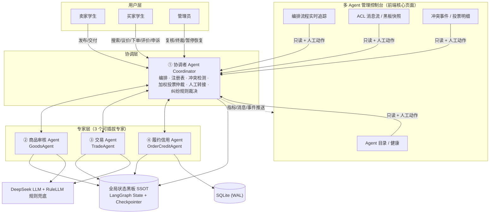
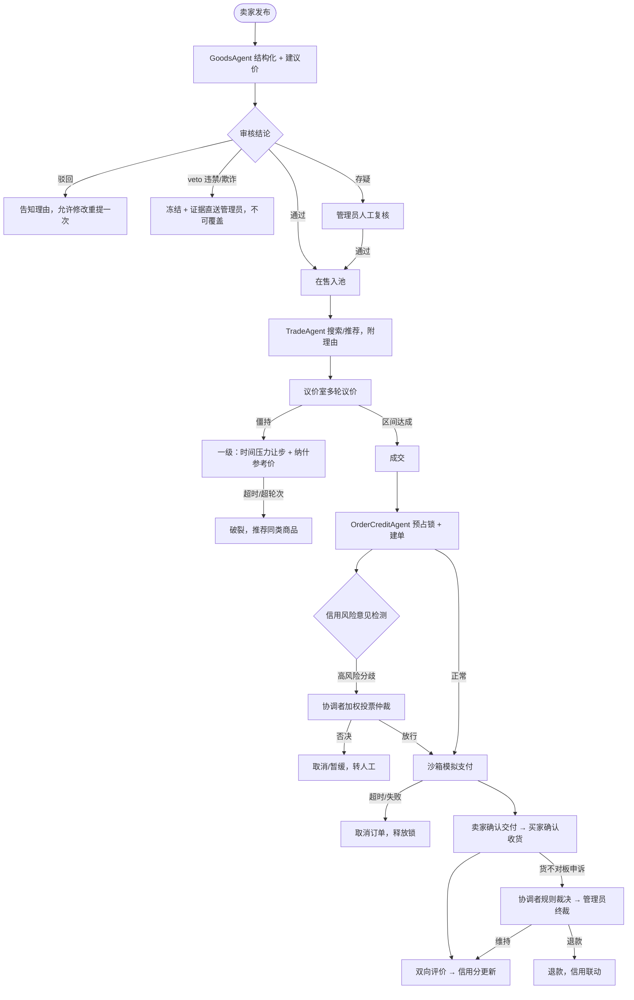
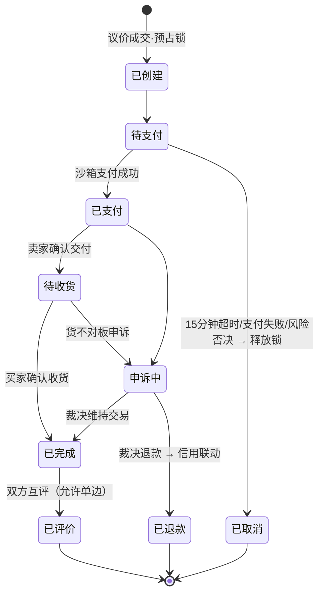

# 校园二手交易平台 Multi-Agent（简约版 / MVP）— 产品需求文档

| 项目 | 内容 |
|---|---|
| 文档定位 | **AI 编码驱动的简约版需求基线**：以最快路径做出"可运行、可演示、视觉顶尖"的版本 |
| 与完整版关系 | 本文由《软件需求规格说明书 V4》（9 Agent / 15 FR / 8 冲突场景）裁剪而来；完整版保留在 `../campus-secondhand-mas/spec.md`，冲突时本文档为 MVP 实现的唯一依据 |
| Agent 规模 | **1 个协调者 + 3 个专家 Agent（共 4 个）** |
| 两大展示重点 | ① **多 Agent 的管理过程可视化（Agent 控制台为核心页面）**；② **业界顶尖水准的前端视觉设计** |
| 日期 | 2026-10-12 |

---

## 1. 概述

### 1.1 一句话定义

一个可本机一键启动的校园二手交易 Web 原型：**4 个 Agent 围绕黑板（SSOT）+ 统一消息协作**，自动跑通"发布 → 审核 → 搜索 → 议价 → 下单 → 模拟支付 → 面交确认 → 互评"全链路；冲突按"**自动协商 → 投票仲裁 → 人工兜底**"升级，违禁品拥有不可覆盖的一票否决权；并提供一个**多 Agent 管理控制台**，实时呈现 Agent 注册、编排流转、消息总线、黑板状态与冲突决策全过程。

### 1.2 目标用户

| 用户 | 核心诉求 |
|---|---|
| 卖家学生 | 发商品、获建议价、参与议价、确认交付、被评价 |
| 买家学生 | 搜商品（带匹配理由）、多轮议价、下单支付、确认收货、评价、申诉 |
| 管理员 | 商品存疑复核、纠纷终裁；通过 Agent 控制台观察/干预系统运行 |
| 答辩演示者（作者本人） | 在控制台上演示"多 Agent 如何被管理与协作"：注册发现、任务流转、消息流、冲突仲裁 |

### 1.3 目标

- **G1**：4 个 Agent 权责清晰、经统一消息契约协作，端到端跑通交易主链路。
- **G2（重点）**：**系统对多 Agent 的管理能力必须被显著地"看见"**——Agent 注册表与健康状态、LangGraph 编排流转、ACL 消息总线、黑板 SSOT 快照、冲突事件与投票明细，全部在管理控制台实时可见、可追溯、可人工干预。
- **G3**：保留 Multi-Agent 研究核心最小形态——意见冲突检测、加权投票仲裁、人工 interrupt 兜底、安全一票否决，覆盖 4 个核心冲突场景。
- **G4**：关键结论（审核、推荐、出价、仲裁）带依据与置信度，全程留痕可查。
- **G5**：LLM 与规则双引擎——已预置 DeepSeek API Key（`.env`，不入文档/仓库），默认走真实 LLM；超时/非法输出自动降级 RuleLLM；**移除 Key 后仍可完整运行**全部流程与剧本，保证答辩稳定。
- **G6**：**前端达到业界顶尖产品的视觉与交互水准**（设计语言统一、动效细腻、信息层次清晰、控制台具备"指挥中心"质感）。
- **G7**：后端以"正确、简单、可演示"为度，**不做高并发/集群/性能优化设计**；单机 SQLite + 事务即可，抢单场景只保证功能正确性。

### 1.4 非目标（本期明确不做）

- 真实支付通道与资金清算（仅沙箱模拟支付、超时取消与释放）；真实物流（仅校内面交确认）。
- 校方统一身份认证对接（种子学号账号模拟）；原生 App；生产级集群部署；Docker；高并发压测与性能调优。
- 真实图片内容识别/鉴黄与文件云存储（图片用 URL 或占位图，只做文本审核）。
- 效用权重界面化 A/B 实验、Agent 熔断后自动接管（保留健康标识与人工暂停/恢复即可）。
- 独立的"用户代理 Agent"与"纠纷仲裁 Agent"（职责并入前端授权确认与协调者，见 2.2）。
- 恶意刷评识别、基于真实数据的 ML 训练、图形化检查点时间旅行回放（以时间线/列表呈现）。

---

## 2. 多 Agent 定义与管理模型（共 4 个）

### 2.1 架构总览



### 2.2 Agent 职责与 V4 裁剪映射

| # | Agent | 职责（MVP） | 吸收的完整版 Agent |
|---|---|---|---|
| ① | **协调者 Coordinator** | ① 接收全部用户请求并按 LangGraph 图编排；② **维护 Agent 注册表、能力清单与健康/启停状态**；③ 冲突检测（规则检测 + 意见检测）；④ 主持二级加权投票仲裁并出裁决记录；⑤ 通过 `interrupt` 把复核/终裁转人工，裁决写回后恢复流程；⑥ 纠纷申诉的规则裁决；⑦ 向控制台推送运行指标、消息流与事件 | 原协调者 + 纠纷仲裁 Agent（简化） |
| ② | **商品审核 GoodsAgent** | 商品信息结构化抽取（标题、类目、成色、关键属性）；基于种子成交价给**建议价区间**；违禁词规则库 + LLM 文本审核，输出 `通过 / 驳回 / 人工复核` + 置信度 + 逐条依据；命中违禁/欺诈时行使**安全一票否决（veto）**；商品上下架 | 原商品管理 + 内容审核 |
| ③ | **交易 TradeAgent** | 在售商品检索排序并给出**匹配理由**；组织买卖双方多轮议价：保密保留价、单调让步、纳什参考价、最大轮次与时限；成交或破裂（推荐同类）；授权区间内代客出价，越界/成交前需用户确认 | 原搜索推荐 + 议价谈判 + 用户代理（授权出价部分） |
| ④ | **履约信用 OrderCreditAgent** | 订单状态机迁移校验；成交时**预占锁**（lock_token + lock_version + 超时点）；抢单裁决唯一成交；沙箱支付与超时释放；面交确认；双向互评、信用分、风险标签与**带置信度的风险意见** | 原交易履约 + 信用评价 |

**统一契约**：所有 Agent 继承同一基类（`name / display_name / avatar / capabilities / description / status(running/paused/error) / llm_mode(llm/rule) / handle(ACLMessage) -> ACLMessage`），经注册表发现，由协调者按图调用；Agent 间不允许直接共享可变状态，只通过黑板与 ACL 消息交互。**新增一个遵循契约的 Agent 只需注册即可被图与控制台识别，无需改协调者核心**。

### 2.3 与完整版的行为差异（AI 实现须知）

1. 没有独立 UserAgent：意图通过**页面表单 + 自然语言输入框**结构化（发布走 GoodsAgent 的 LLM 抽取；议价走出价按钮 + 授权区间自动出价）。
2. 没有独立 Arbitrator：申诉进入协调者**规则裁决**，证据不足转管理员；管理员终裁为最终结论。
3. 不做"信息冲突自动纠正"（原 C7）与"推荐佣金偏向"（原 C5）：黑板是唯一写入源。
4. 二级仲裁以**加权投票**为准；效用思想仅体现在票权配置中，不做效用函数计算界面。
5. 并发抢单只保证"恰一单成交"的功能正确性，用数据库事务 + 乐观锁实现即可，**不做高并发吞吐设计、不做压测**。

### 2.4 多 Agent 管理能力（本项目的演示重点，控制台必须呈现）

| 管理能力 | 最小实现 |
|---|---|
| 注册与发现 | 4 个 Agent 启动时自动注册；控制台展示名称、图标、职责、能力标签、契约信息 |
| 健康与模式 | 实时 `running/paused/error` 状态、当前引擎 `llm/rule`、本次运行处理消息数/任务数、最近活跃时间；管理员可**暂停/恢复**任一专家（暂停后其流程被协调者挂起并给出友好提示） |
| 编排管理 | 主链路节点图（发布审核→搜索→议价→建单→风险检测→支付→交付→评价；含冲突分支与人工节点）；执行一次业务时**当前节点高亮、已走路径连线点亮**；可按 thread/订单查看在途与历史流程实例 |
| 消息总线监控 | ACL 消息实时流（WS 推送）：performative 彩色标签、发送→接收方动画、置信度、时间；支持按会话/Agent/performative 过滤与点击查看 payload |
| 黑板观察 | 当前在途流程的 State 结构化快照（键值/JSON 双视图）与检查点列表 |
| 冲突管理 | 冲突事件时间线（C1/C2/C6/C8 分类筛选）；二级投票明细可视化（各 Agent 票值/权重/置信度/加权分）；三级人工任务在此直达复核/终裁台 |
| 人工干预 | 控制台与管理员工作台共用 interrupt 通道：冻结动作、终裁写回、Agent 暂停/恢复，全部留痕 |

---

## 3. 交易主链路与状态机

### 3.1 主链路（含异常路径）



### 3.2 商品状态

`草稿 → 待审核 → 在售（可被锁定）→ 已成交`；分支态：`驳回`（可修改重提一次）、`冻结`（veto/人工）、`下架`（卖家主动，仅未锁定可下架）。

### 3.3 订单状态机（唯一权威定义）



非法迁移一律拒绝并返回错误码；所有迁移写审计日志（谁、何时、从什么态到什么态、依据）。

---

## 4. 数据模型（SQLModel / SQLite，字段级以此为准）

| 表 | 关键字段 |
|---|---|
| `user` | id、学号 student_no（唯一）、密码哈希、昵称、角色（buyer/seller 双布尔）、is_admin、credit_score（初值 100）、risk_tag（normal/new/high_risk）、status（active/frozen）、created_at |
| `item` | id、seller_id、title、category、condition_level、attrs(JSON)、description、image_url、price_suggest_min/max、price、status（见 3.2）、lock_version（默认 0）、audit_reason、created_at |
| `negotiation` | id、item_id、buyer_id、seller_id、buyer_reserve、seller_reserve、nash_price、max_rounds(5)、deadline_seconds(120)、status（ongoing/deal/terminated）、deal_price、graph_thread_id、created_at |
| `offer` | id、negotiation_id、round、from_role、price、basis、created_at；序列满足单调让步 |
| `order` | id、order_no、item_id、negotiation_id、buyer_id、seller_id、deal_price、status（见 3.3）、lock_token、pay_deadline、graph_thread_id、created_at、updated_at |
| `review` | id、order_id、from_user_id、to_user_id、score(1–5)、content、created_at；每订单每方向唯一 |
| `appeal` | id、order_id、appellant_id、reason、evidence(JSON)、status（pending/ruled/closed）、ruling（uphold/refund）、ruling_basis、judged_by、created_at |
| `acl_message` | id、conversation_id、performative（request/inform/propose/accept/reject/refuse/arbitrate/veto/interrupt）、sender、receiver、payload(JSON)、confidence(0–1)、timeout、error_code、graph_thread_id、created_at |
| `conflict_event` | id、scene（C1/C2/C6/C8/other）、type（resource/opinion/safety）、level（1/2/3）、participants(JSON)、payload(JSON：投票明细/裁决依据)、result、graph_thread_id、created_at |
| `agent_status` | id、name（唯一）、display_name、avatar、capabilities(JSON)、description、runtime_status（running/paused/error）、llm_mode（llm/rule）、msg_handled、tasks_handled、last_active_at、updated_at |
| `audit_log` | id、actor_type（user/admin/agent）、actor_id、action、target_type、target_id、detail(JSON)、created_at |

信用分规则（配置化初值）：初始 100；好评 +2 / 中评 0 / 差评 -5；被裁决责任方 -15；支付超时取消 -2；`new` = 成交 0 单，`high_risk` = 信用分 < 80 或近 5 单责任纠纷 ≥ 1。

---

## 5. 功能需求

> 每条按【触发 / 规则 / 结果 / 异常】描述。金额为人民币模拟币。

### FR-1 账号与认证

- 【触发】注册、登录、系统首次启动。
- 【规则】学号 + 密码注册，bcrypt 哈希；登录签发 JWT；同一账号可买可卖；管理员预置。首次启动播种：**作者账号 2400320321**、≥3 卖家、≥3 买家（含 1 个高风险样本）、≥8 个跨类目在售商品、违禁词库 ≥20 词。
- 【结果】持令牌访问角色接口；冻结账号禁止交易类操作（可申诉）。
- 【异常】口令错误/令牌问题 401；越权 403。

### FR-2 商品审核 Agent（GoodsAgent）

- 【触发】卖家提交商品（自然语言或表单）；驳回后重提。
- 【规则】① LLM 抽取标题/类目/成色/属性（RuleLLM 兜底），缺关键字段退回；② 同类目种子成交价给建议区间（仅建议）；③ 违禁词规则库 + LLM 文本判定输出三档结论 + 置信度 + 逐条依据；命中违禁/欺诈直接 **veto**。
- 【结果】通过→`在售`；驳回→告知理由，**仅允许重提一次**；存疑→人工复核台；veto→`冻结` + 通知 + 证据入复核台，**任何投票/仲裁不得覆盖**。
- 【异常】LLM 超时/非法输出→重试 1 次→规则库；规则与 LLM 结论相反且置信度均 ≥0.5 → 人工复核。

### FR-3 交易 Agent（TradeAgent：搜索推荐 + 议价）

- 【触发】检索；发起议价及后续出价。
- 【规则】
  1. 仅检索`在售`；综合相关性、成色、价格匹配、卖家信用排序；**每条结果给可展示理由**；无结果给宽松条件建议。
  2. 议价维护双方**互不可见保留价**；5 轮、120 秒可配。
  3. **单调让步**：买家出价只升、卖家要价只降；授权区间内自动出价，**越界或接受成交前必须前端确认**。
  4. **纳什参考价**：可行成交区间内双方让步空间乘积最大点，议价室展示。
  5. 接受/出价入交集即成交；超轮次/超时/退出即破裂并返回同类推荐。
  6. 高风险对方在议价室显示风险提示，不代替决策。
- 【结果】成交→协调者触发建单；破裂→会话终止；出价序列与依据落 `offer`。
- 【异常】僵持先走一级自动让步（纳什价 + 解释），仍失败破裂并记 C1。

### FR-4 履约信用 Agent（OrderCreditAgent）

- 【触发】成交建单；支付/交付/超时；互评；裁决回写。
- 【规则】
  1. 建单事务内乐观版本号加预占锁（lock_token、15 分钟支付时限）；并发抢单按"下单时间 → 信用分 → 支付完成"裁决唯一成交，其余返回冲突错误与替代推荐。**以功能正确为限，不做并发性能优化**。
  2. 严格按 3.3 状态机迁移；重复支付幂等拒绝；超时懒判定取消并释放锁。
  3. 沙箱支付：点"支付"即成功（无充值体系）。
  4. 卖家交付 → 买家收货 → `已完成` → 双向评价（每方向一次）。
  5. 按第 4 章更新信用分/标签；每笔交易输出风险意见 `risk_level/confidence/basis`。
- 【结果】订单/锁/信用一致可查；迁移全量审计。
- 【异常】对锁定/已成交商品下单→C2 事件；退款裁决联动扣分。

### FR-5 协调者 Agent（Coordinator）

- 【触发】全部用户请求、Agent 上报、申诉、管理员写回。
- 【规则】
  1. 以 LangGraph 编排主流程（发布审核流、搜索、议价流、交易流、申诉流），状态入黑板并持久化检查点；每次节点流转产出节点轨迹事件供控制台高亮。
  2. **规则检测**：锁冲突、非法迁移、重复动作直接拦截。
  3. **意见检测**：支付前 OrderCreditAgent high(conf≥0.6) 与放行倾向相左→二级投票（6.2/6.3）记 C6；否决则暂缓/取消并转人工。
  4. 申诉：证据包（商品快照、出价序列、订单节点、信用历史）→规则裁决（责任清晰且 ≤50 元直裁 uphold/refund），其余 interrupt 转管理员，写回驱动迁移。
  5. 注册表与健康管理：启动注册、心跳式最近活跃、msg/task 计数；支持管理员暂停/恢复专家；LLM 降级时 `llm_mode=rule`、健康可标 degraded 但不熔断流程。
- 【结果】跳转、裁决、干预全部写 `conflict_event`/`audit_log` 并推送控制台。

### FR-6 黑板 SSOT 与 ACL 消息

- 【规则】运行态以 LangGraph 类型化 State + SQLite Checkpointer 为唯一事实源；ACL Schema（第 4 章 `acl_message`）统一，performative 限枚举，出站经 Pydantic 校验，非法消息拒绝并记录错误码；**每条消息持久化后实时推送控制台消息流**；决策可经审计时间线回溯。

### FR-7 管理员工作台

- 【规则】① **商品复核台**：存疑商品 + veto 通知，看逐条依据，操作通过/维持冻结；② **纠纷终裁台**：证据包 + 协调者建议，裁决维持/退款（必填依据）。动作强制留痕，写回黑板驱动状态与信用。

### FR-8 冲突剧本模拟

- 【规则】内置 **4 剧本**（C1/C2/C6/C8），CLI 一键运行（`python -m app.scenarios.run_all`），输出逐步消息轨迹与"期望—实际"对照表；同时在控制台留下可观察的事件流；无 Key 模式必须同样通过。

### FR-9 Web 前端（基础体验，视觉要求见 FR-11）

| 端 | 必需页面 |
|---|---|
| 通用 | 登录/注册、首页导航 |
| 卖家 | 商品发布（自然语言 + 结构化可编辑 + 建议价）、我的商品（状态/依据/重提）、议价室、订单与交付、收到的评价 |
| 买家 | 市场搜索（筛选 + 匹配理由）、商品详情、议价室（出价/纳什价/轮次/倒计时/风险提示/越界确认）、下单与模拟支付、我的订单（收货/申诉）、评价、我的信用 |
| 管理员 | 商品复核台、纠纷终裁台、**多 Agent 管理控制台（FR-10）** |

交互底线：所有异步动作有 loading 与结果反馈；议价室与控制台用 WebSocket 实时刷新；越权/登录失效明确跳转。

### FR-10 多 Agent 管理控制台（管理员可见，项目演示核心）

- 【页面与功能】
  1. **Agent 总览**：4 张 Agent 卡片（图标、名称、角色定位、能力标签、运行状态灯、llm/rule 引擎标、消息/任务计数、最近活跃）；暂停/恢复开关（暂停后相关业务流程返回"Agent 已暂停"提示并在控制台显示挂起）。
  2. **编排追踪**：主链路节点图（含冲突/人工分支），选择一个在途或历史流程实例（按订单/会话/thread）后，已完成节点点亮、当前节点呼吸高亮、节点上可悬停查看该节点输入输出摘要；底部为该实例的节点流转时间线。
  3. **消息总线**：ACL 消息实时流，performative 彩色标签 + sender→receiver 流向动效，可按 Agent/performative/conversation 过滤，点击展开 payload、置信度与错误码。
  4. **黑板快照**：选中实例的 State 树形/JSON 双视图与检查点列表（时间、节点）。
  5. **冲突中心**：冲突事件时间线（C1/C2/C6/C8 筛选）+ 投票详情卡（各方票值、权重、置信度、加权分仪表条、放行/拦截/转人工结论）+ 人工待办快捷入口（与 FR-7 联动）。
- 【数据接口】REST：agent 列表/状态/暂停恢复、流程实例列表、实例节点轨迹、检查点列表、冲突事件列表/详情；WS `/ws/control`：消息流、节点轨迹、计数增量、状态变更、新冲突事件推送。
- 【结果】演示者无需看后端日志即可完整讲解"系统如何管理 4 个 Agent 协作"。

### FR-11 视觉与交互设计标准（前端验收基线）

- 【设计基调】现代、克制、有科技感的"校园 × AI"产品气质：统一设计 Token（主色建议靛蓝—青蓝渐变体系，语义色齐全）、统一圆角/间距/阴影/字体阶、Element Plus 深度主题定制（禁止默认毛坯样式）；玻璃拟态卡片、细腻微动效（页面过渡、卡片悬停、状态灯呼吸、消息流入、流程连线点亮）。
- 【控制台】深色"指挥中心（Mission Control）"质感：暗色背景、霓虹状态色、发光节点与数据流、高密度但层次清晰的信息排布；业务页面采用明亮浅色主题，二者风格统一（同一套品牌基因）。
- 【品质要求】空状态/骨架屏/加载/错误/Toast 齐全；图表（投票加权分、信用等）精致；图标统一（建议 lucide 风格图标库）；页面在 1440px 桌面宽度达到设计稿级完成度，兼容 1280px。
- 【禁止】Element Plus 默认配色裸用、表格/表单堆叠无层次、纯色块拼接、无反馈的按钮点击。

---

## 6. 冲突决策机制（保留的最小研究内核）

### 6.1 冲突检测（实现 2 种）

1. **规则检测**：预占锁、状态机、唯一约束（重复评价/下单）。
2. **意见检测**：支付前比对放行倾向与 OrderCreditAgent 高风险意见（confidence ≥ 0.6），相左触发二级投票。

### 6.2 三级阶梯在 MVP 中的映射

| 级别 | MVP 实现 | 覆盖场景 |
|---|---|---|
| 一级·自动协商 | TradeAgent：时间压力让步 + 纳什参考价 + 规则解释，5 轮/120 秒 | C1 |
| 二级·投票仲裁 | Coordinator 主持：专业权重 × 置信度投票，加权分 ≥ 0.5 放行，否则拦截；明细入 `conflict_event` 并推送控制台 | C2（规则即裁决）、C6 |
| 三级·人工兜底 | LangGraph `interrupt` 冻结 → 工作台/控制台终裁 → 写回恢复；veto 直入本级且不可被推翻 | C8、C6 升级、申诉 |

### 6.3 加权投票规则

- 票权（配置化）：OrderCreditAgent 0.5、GoodsAgent 0.2、Coordinator（安全视角）0.3。
- 票值 `{-1, 0, +1}`；**加权分 = Σ(票权 × 置信度 × 票值)**；≥ +0.5 放行，≤ -0.5 拦截，中间转人工。
- 出现欺诈安全特征按 6.4 直接否决，不进入投票。

### 6.4 安全底线

GoodsAgent 的 veto **高于一切**：商品立即冻结、不得上架；人工仅可在证据推翻违禁判定时解除冻结（须留痕），不存在"放行违禁商品"的操作路径。确定性规则优先于 LLM 输出。

### 6.5 四个必做冲突场景（验收对照表）

| # | 场景 | 类型 | 触发构造 | 期望结果 |
|---|---|---|---|---|
| C1 | 议价僵持 | 目标 | 保留价无交集或 5 轮不让步 | 纳什价与让步建议展示，超时 terminated、返回同类推荐，记 C1 事件 |
| C2 | 并发抢单 | 资源 | 两买家对同一商品并发建单/支付 | 恰一单成功；另一单拒绝 + 替代推荐；无超卖（功能正确性即可） |
| C6 | 信用风险分歧 | 意见 | 高风险买家支付 | 投票明细（票值/权重/置信度/加权分）入事件并在控制台可视化；拦截则转人工 |
| C8 | 违禁品发布 | 安全 | 描述含种子违禁词 | veto 冻结、不上架、卖家可见理由、控制台与复核台出现证据；无法被覆盖 |

---

## 7. 技术栈与工程约束

| 项 | 选型 | 说明 |
|---|---|---|
| 语言/后端 | Python 3.11+、FastAPI、Uvicorn | 自动 OpenAPI；WS 承载议价室与控制台推送 |
| Agent 编排 | LangGraph 1.x | StateGraph + 条件边 + SQLite Checkpointer + `interrupt` |
| 数据 | SQLModel + SQLite（WAL） | 事务 + 乐观版本号；**不引入 Redis/Postgres，不做并发优化** |
| 契约/校验 | Pydantic v2 | ACL、Agent IO、API Schema |
| 认证 | python-jose（JWT）+ passlib[bcrypt] | — |
| LLM | openai SDK 指向 DeepSeek + **RuleLLM 兜底** | Key 放 `backend/.env`（已预置，`.gitignore` 忽略）；超时/非法 JSON→重试 1 次→规则降级 |
| 前端 | Vue 3 + TS + Vite + Pinia + Vue Router + Element Plus（深度定制主题） | 图标 unplugin-icons（lucide）；动效以 Vue Transition + CSS 为主，轻量 GSAP 可选 |
| 控制台可视化 | 自定义 SVG 节点图 + CSS 动效；图表用 ECharts（仅投票仪表/统计等少量图表） | 不引重做图框架 |
| 测试 | pytest + pytest-asyncio + httpx | 单元/接口/抢单正确性/故障注入/无 Key 回归 |
| 配置 | pydantic-settings + `.env` | 全部阈值配置化 |

目录约定：

```text
backend/
  app/
    main.py                # FastAPI 入口、REST/WS 注册
    core/                  # config(.env) / security / database
    models/                # SQLModel 表
    schemas/               # Pydantic API/ACL 契约
    agents/                # base + coordinator + goods + trade + order_credit
    graph/                 # 图、节点、条件边、checkpoint、轨迹事件
    kernel/                # ACL、黑板、注册表、冲突检测/投票、WS 推送总线
    llm/                   # client + rule_llm
    services/  api/        # 业务服务与 REST
    seeds/                 # 账号/商品/违禁词
    scenarios/             # c1~c4 + run_all.py
  tests/
frontend/
  src/{api,ws,stores,router,styles,components,views}/
    styles/                # design tokens / 主题 / 动效
    views/console/         # Agent 管理控制台
```

REST 范围（`/api`）：auth、items、moderation、market、negotiations（+`/ws/negotiation/{id}`）、orders、reviews、appeals、audit、**console（agents、instances、trace、checkpoints、conflicts；+`/ws/control`）**。统一信封 `{code, message, data}`。

---

## 8. 非功能需求

| 编号 | 要求 | 可验证标准 |
|---|---|---|
| NFR-1 双模式可运行 | 预置 Key 时真实 LLM 工作正常；移除 Key 后主链路与 4 剧本照样跑通 | 两种环境各执行一次主链路与 `run_all` 成功 |
| NFR-2 交易一致性 | 同一商品绝不重复成交；评价/支付幂等（功能正确性，不设性能指标） | 两路并发用例恰一单成功；重复请求返回错误码且无脏数据 |
| NFR-3 可解释 | 审核/推荐/出价/风险/裁决带依据，订单时间线可查 | 界面与接口响应可直接读到依据与置信度 |
| NFR-4 Agent 可管理 | 4 Agent 注册可见、状态与计数实时、可暂停恢复、流转/消息/黑板/冲突可观察 | 控制台逐项走查（对应 AC-11） |
| NFR-5 LLM 稳健 | 非法 JSON/超时→重试→降级或转人工 | 故障注入后 DB/黑板状态一致 |
| NFR-6 安全 | 密码哈希、JWT、按用户隔离、veto 不可覆盖 | 越权测试 + C8 剧本 |
| NFR-7 视觉品质 | 全界面达到 FR-11 设计标准 | AC-12 视觉评审 ≥4 |
| NFR-8 工程质量 | 类型注解、pytest 核心覆盖、照 README 一键可启动 | 测试通过；干净目录照做成功 |

---

## 9. 假设与依赖

- 【已确认】DeepSeek Key 由作者提供并预置于 `backend/.env`（不入库不入文档）；失效/移除时自动 RuleLLM 全量兜底。
- 【假设】前端固定 Vue 3 + Element Plus 深度定制；图片仅 URL/占位；仅简体中文。
- 【依赖】Python 3.11+、Node.js LTS。
- 【假设】全部阈值（5 轮/120 秒、15 分钟、信用规则、投票 ±0.5、置信度 0.6、直裁 50 元）集中在配置文件，可在 `.env` 调整。

---

## 10. 验收标准

### AC-1 安全一票否决不可覆盖 `rule`
- **Given** 商品命中违禁/欺诈规则；**When** 任何流程尝试使其上架；**Then** 商品保持`冻结`、无法进入在售池，证据与尝试均有审计与控制台记录。
- **Pass Condition**：C8 剧本通过 + 冻结商品上架接口被拒。
- **Evidence**：`run_all` 输出、商品状态、`audit_log`。

### AC-2 交易主链路端到端贯通 `rule`
- 登录→发布→审核→搜索→议价成交→建单→支付→交付确认→互评后，订单`已评价`、商品`已成交`、信用分按规则变化，依据可在订单时间线查看。
- **Evidence**：E2E pytest + 前端走查截图。

### AC-3 并发抢单一致性 `rule`
- 两路并发建单支付恰一单成功，另一单收冲突错误与替代推荐，不超卖、锁正确释放/消费。
- **Evidence**：并发用例与 DB 断言（功能正确性，不做性能度量）。

### AC-4 议价规则正确 `rule`
- 成交/5 轮僵持/保留价无交集三场景：单调让步、纳什价计算持久化、交集外不成交、破裂返回同类、越界自动出价被拦。
- **Evidence**：offer 序列断言 + C1 剧本。

### AC-5 意见冲突投票与人工兜底闭环 `rule`
- C6 构造下投票明细完整落库；转人工时 interrupt 冻结，终裁写回后订单正确迁移（放行继续 / 拦截取消释放锁）。
- **Evidence**：C6 剧本 + `conflict_event` + 状态断言。

### AC-6 双引擎模式均可完整运行 `rule`
- 预置 Key 时真实 LLM 链路成功；移除 Key 后主链路与 C1/C2/C6/C8 全部通过且结构化输出合法。
- **Evidence**：两种环境运行日志。

### AC-7 ACL 消息契约统一 `rule`
- Agent 间消息 100% 经 ACL 模型校验；缺字段/非法 performative/置信度越界被拒并留错误码。
- **Evidence**：消息校验单测。

### AC-8 LLM 故障不产生脏状态 `rule`
- 注入超时/非法 JSON：重试一次后降级或转人工，无半写入、非法状态。
- **Evidence**：故障注入测试 + 一致性断言。

### AC-9 前端核心旅程可用性 `rubric`
- **Dimension**：三类角色核心页面完整性、议价室实时反馈、错误提示清晰度。
- **Scale 1–5**：1=残缺；3=主流程可用反馈弱；5=全流程顺畅、状态依据实时清晰。**Threshold ≥ 4**。
- **Evidence**：逐页走查截图。

### AC-10 工程可运行性与代码质量 `rubric`
- **Dimension**：分层、契约一致性、配置化、测试、一键启动。
- **Scale 1–5**：1=无法启动；3=可跑但混乱；5=照 README 即起、测试齐备、Agent 注册即可插拔。**Threshold ≥ 4**。
- **Evidence**：干净环境执行记录 + 测试报告。

### AC-11 多 Agent 管理控制台完整有效 `rule`
- **Given** 系统运行并依次执行若干业务（含一次 C6 与一次 C8）；**When** 打开控制台各面板；**Then**：
  1. Agent 总览显示 4 个 Agent 的能力、运行灯、引擎模式、实时计数与最近活跃；暂停某专家后其新业务被挂起并提示，恢复后继续；
  2. 编排追踪中所选流程实例的已走节点点亮、当前节点高亮，节点摘要与时间线与实际执行一致；
  3. 消息总线实时收到本次执行的 ACL 消息（方向、performative、置信度正确），可过滤、可展开 payload；
  4. 黑板快照与检查点列表可读且与库中状态一致；
  5. 冲突中心可见 C6 投票明细（票值/权重/置信度/加权分/结论）与 C8 事件，并能跳转人工处理。
- **Evidence**：控制台操作录屏/截图 + WS 报文与库记录比对。

### AC-12 前端视觉与交互顶尖度 `rubric`
- **Dimension**：设计 Token 统一性、主题定制深度、动效质感、控制台"指挥中心"氛围、信息层次与空/错/载状态完整度（对照 FR-11）。
- **Scale 1–5**：1=Element Plus 默认毛坯感；3=整洁但模板化、无记忆点；5=达到一线商业产品/Dribbble 高水准稿的观感，浅色业务端与深色控制台品牌统一、动效细腻有节制。
- **Pass Threshold**：≥ 4。
- **Evidence**：主要页面全量截图（含控制台暗色面板、议价室、登录页、发布页、市场页）设计评审。

---

## 11. 开放问题（均有默认值，不阻塞开工）

1. 买家自动出价默认授权区间 = 其保留价（议价室提供关闭开关）——可否？
2. 申诉直裁阈值 50 元——可否？
3. 控制台是否对非管理员只读可见？（默认：仅管理员可见，答辩时使用管理员账号。）
